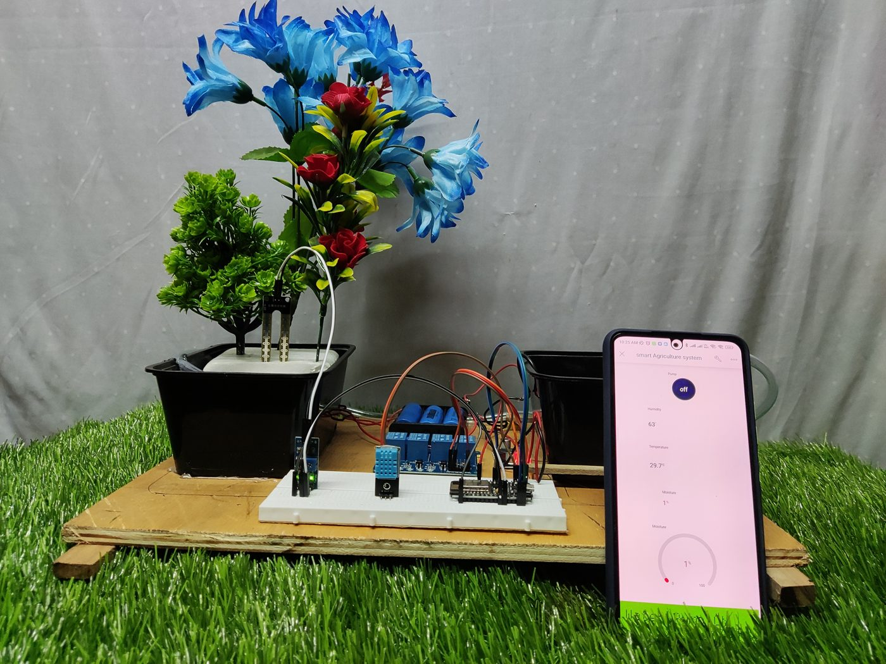
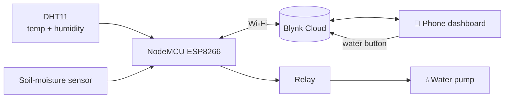
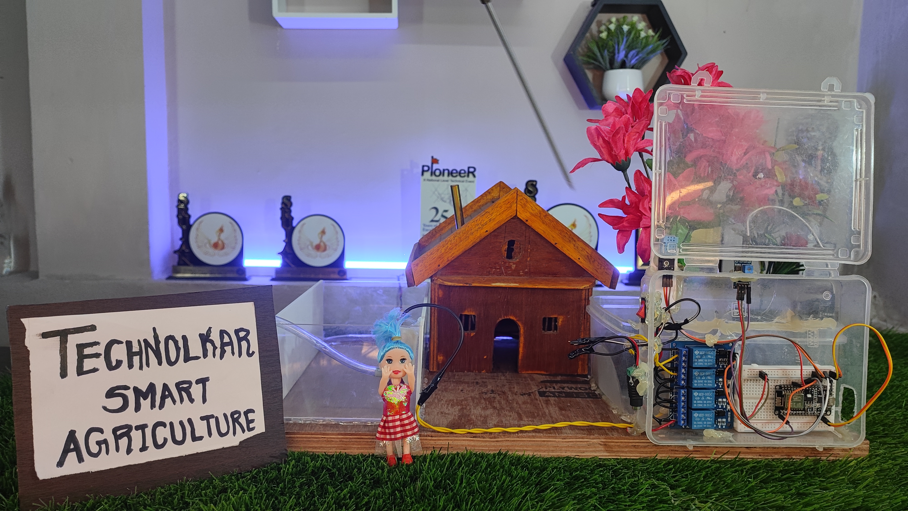

<div align="center">


### 🪴 Your plants send you their status — and you water them from your phone.


</div>

---

## 📌 At a glance

> A NodeMCU reads **soil moisture**, **temperature** and **humidity** and sends them live to a **Blynk phone dashboard**. The moisture gauge turns **green when the soil is wet and red when it is dry** — and a relay-controlled **water pump** lets you water the plant from anywhere.

<div align="center">
<table>
<tr>
<td align="center" width="50%"><br/><sub><b>Prototype</b> with the Blynk dashboard on a phone</sub></td>
<td align="center" width="50%"><br/><sub><b>Setup</b> — NodeMCU, relays, pump and water tanks</sub></td>
</tr>
</table>
</div>

---

## ✨ Features

| | |
|---|---|
| 🌡️ **Climate sensing** | Temperature and humidity from a DHT11 |
| 💧 **Soil sensing** | Analog soil-moisture sensor |
| 📱 **Live dashboard** | Values on Blynk virtual pins `V10`, `V11`, `V12` |
| 🟢🔴 **Instant status** | Moisture widget turns green (wet) or red (dry) |
| 🚿 **Remote watering** | Pump switched through a relay from the app |

---

## 🔄 How it works



---

## 💻 Code

[`SOIL_AND_HUMIDITY_SENSOR_IOT.ino`](SOIL_AND_HUMIDITY_SENSOR_IOT.ino):

```cpp
void loop() {
  Blynk.run();
  float h = dht.readHumidity();
  float t = dht.readTemperature();
  int   m = analogRead(A0);

  Blynk.virtualWrite(V10, h);
  Blynk.virtualWrite(V11, t);
  Blynk.virtualWrite(V12, m);
  Blynk.setProperty(V12, "color", m <= 1000 ? "#00FF00" : "#FF0000");  // wet / dry
}
```

<details>
<summary><b>▶ How to run it</b></summary>

1. Install the **ESP8266 board package**, **Blynk** and **DHT sensor library**
2. Enter **your own** Blynk template ID, auth token and Wi-Fi details
3. Wire the DHT11 to D4 and the soil sensor to A0, then upload
4. Add gauges on `V10`–`V12` and a button for the pump relay in the Blynk app

</details>

---

## 🌱 Related work

The same idea also went into the **Technolkar smart-agriculture display** shown below. Related projects:
the [**offline mesh farm monitor**](https://github.com/technolkar/Mesh-Networking-for-smart-agriculture-system-without-Internet) and the [**solar agriculture robot**](https://github.com/technolkar/Multipurpose-Agriculture-Robot-).

<div align="center">

<br/><sub><b>Technolkar Smart Agriculture</b> display model</sub>
</div>

---

<div align="center">

### 👋 Built by **Ajay Arjun Mannolkar**
[](https://technolkar.github.io)
[](https://www.linkedin.com/in/ajaymannolkar)
[](https://www.youtube.com/@TechnolkarInnovations)


</div>
